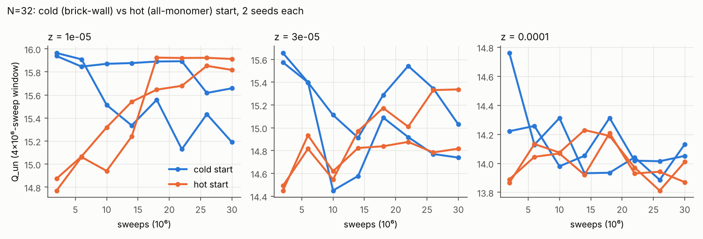

# 진단 보고: N=32 작은 z의 평형과 이완 시간 (2026-10-30)

## 요약

- N=32를 차가운 시작(벽돌 배치, 빈칸 0개) 2개와 뜨거운 시작(모든 칸 빈칸) 2개로, 각 3.2×10⁷ 스윕(1차 생산의 3.2배) 돌렸다. 사다리는 `ladder.py` 설계로 복제본 25개, 최소 교환 수락률 0.33이다.
- **z ≥ 10⁻⁴는 해결됐다.** 두 시작이 수백만 스윕 안에 같은 값으로 수렴한다. 자기상관 시간은 z=10⁻⁴에서 약 2×10⁵ 스윕, z ≥ 10⁻³에서 약 2.5×10⁴ 스윕이다.
- **z ≤ 3×10⁻⁵는 초기 조건 문제가 아니라 평형 자체의 느린 요동이다.** Q_un이 약 0.7 차이 나는 두 상태(빈칸 쌍이 변에 붙어 있음 / 없음)를 오가고, 한 상태에 머무는 시간이 10⁶–10⁷ 스윕이다. z=10⁻⁵에서 씨앗 하나는 3.2×10⁷ 스윕 내내 한 상태에 머물렀다.
- 원인: 작은 z에서 빈칸 쌍 생성은 국소 이동으로 시도당 확률 z²라서 극히 드물다. 병렬 템퍼링이 이것을 우회하려면 배치가 큰 z에서 내려와야 하는데, **z ≈ 10⁻⁴–6×10⁻⁴ 구간에서 복제본 흐름이 막힌다.** 교환 수락률은 0.36–0.5로 충분한데도 왕복 한 번에 7×10⁶–1.2×10⁷ 스윕이 걸린다. 병목은 사다리 간격이 아니라 그 z에서의 국소 이완 자체다.
- **결론:** 현재 알고리즘으로 N=32의 판가름 창(z ≤ 3×10⁻⁵)을 ±0.1로 재려면 씨앗당 약 2–3×10⁷ 스윕(4씨앗)이 필요하다. N과 함께 이 시간은 적어도 N²로 늘어난다. 의뢰서 예산(N=48 2×10⁷, N=64 3×10⁷)은 부족하다. 아래 수정 계획을 제안한다.

## 1. 평형값 (첫 8×10⁶ 스윕 버림, 4개 실행 합산)

| z | Q_un | 오차(씨앗 편차) | Q_un − log₂(1/z) | 비고 | 1차 생산값 |
|---|---|---|---|---|---|
| 10⁻⁵ | 15.61 | 0.09 (과소 가능) | −1.00 | 두 상태 전환, τ ≳ 10⁷ | 15.86 (높게 치우침) |
| 3×10⁻⁵ | 14.95 | 0.11 | −0.07 | 두 상태 전환, τ ≈ 4×10⁶ | 15.04 |
| 10⁻⁴ | 14.037 | 0.017 | +0.749 | 수렴 | 14.03 |
| 3×10⁻⁴ | 13.059 | 0.007 | +1.356 | 수렴 | 13.02 |
| 10⁻³ | 11.640 | 0.008 | +1.674 | 수렴 | 11.641 |
| 3×10⁻³ | 10.067 | 0.003 | +1.686 | 수렴 | 10.077 |
| 10⁻² | 7.983 | 0.001 | +1.339 | 수렴 | 7.986 |
| 3×10⁻² | 5.771 | 0.0005 | +0.712 | 수렴 | 5.770 |
| 0.1 | 3.418 | 0.001 | +0.096 | 수렴 | 3.418 |

- z ≥ 10⁻⁴에서는 1차 생산값과 0.04 안에서 맞는다. 1차 생산의 문제는 z ≤ 3×10⁻⁵에 한정되고, z=10⁻⁵ 값은 0.25 높게 치우쳐 있었다.
- N=32에서는 z ≤ 10⁻⁴에서 N* = 2 log₂(1/z) = 27–33이라 N ≈ N*다. 여기서는 H1 영역(N* ≪ N)에 들어가지 않는다. Q_un − log₂(1/z)가 z마다 −1.0에서 +1.7까지 다른 것은 아직 H1/H2 판단의 근거가 아니다.

그림 3: 차가운 시작(파랑)과 뜨거운 시작(주황), 4×10⁶ 스윕 구간 평균.

## 2. 복제본 흐름

| 씨앗 | 왕복 횟수 | 평균 왕복 (스윕) |
|---|---|---|
| 21 (차가운) | 17 | 1.2×10⁷ |
| 22 (차가운) | 55 | 9.4×10⁶ |
| 23 (뜨거운) | 65 | 7.1×10⁶ |
| 24 (뜨거운) | 61 | 7.7×10⁶ |

f_up(마지막으로 바닥을 들른 배치의 비율)은 z=5.5×10⁻⁵에서 0.96–0.98, 10⁻⁴에서 0.79–0.88, 3×10⁻⁴에서 0.25–0.36, 10⁻³에서 0.04–0.06이다. 흐름은 z ≈ 10⁻⁴–10⁻³에서 막힌다. 이 구간의 교환 수락률은 0.36–0.54다. z > 10⁻³의 복제본(25개 중 16개)은 작은 z의 평형에 거의 기여하지 않는다.

## 3. 다른 확인

- `pt_analyze.py`의 drift 판정(전반·후반, 비닝 오차)은 이런 느린 두 상태 전환을 잡지 못한다. 앞으로는 씨앗 간 편차 기반 판정(`trend.py`, `diag_analyze.py`)과 차가운/뜨거운 시작 비교를 기준으로 쓴다.
- 정확 계산 N=20 (`diag/exact_N20.txt`): z=10⁻⁴에서 Q_un=9.980, 10⁻⁵에서 9.9998로 N/2에 가깝다. N=20은 작은 z에서 녹기 전 영역이라 이 문제의 검증 기준으로는 약하다.

## 4. 수정 계획 (N=48, 64)

### (1) 사다리를 둘로 나눈다

- **작은 z 사다리 [10⁻⁵, 10⁻³]:** 판가름 창. 길게 돌린다. 큰 z 복제본이 작은 z 평형에 기여하지 않으므로 빼도 손해가 없고, 비용은 복제본 수에 비례해 줄어든다(N=32: 25개 → 9개).
- **큰 z 사다리 [10⁻³, 0.1]:** τ ≈ 2.5×10⁴ 스윕이라 짧게 돌린다. Ψ(s), c(z) 분석(그림 2, 3)용이다.
- 두 사다리 모두 z=10⁻³을 포함해 겹치는 점으로 일관성을 확인한다.

### (2) 작은 z 생산의 예산과 판정

- 씨앗 4개 중 2개는 차가운 시작, 2개는 뜨거운 시작으로 돌린다. 두 쪽 평균이 오차 안에서 맞아야 통과로 한다.
- N=48을 먼저 돌려 τ를 직접 잰다. τ ∝ N²로 가정하면 N=48에서 ±0.1을 얻는 데 씨앗당 약 6×10⁷ 스윕이 든다. 작은 z 사다리 복제본 약 18개 기준으로 씨앗당 약 32시간이고, 4코어에서 씨앗 4개를 함께 돌려 약 1.5일이다.
- 큰 z 사다리 N=48은 씨앗당 약 3시간이다.

### (3) N=64는 이 환경 밖에서

- τ ∝ N²로 가정해도 N=64의 작은 z는 씨앗당 약 1.1×10⁸ 스윕, 약 5–6일(약 135 코어·시간)이 든다. 이 4코어 컨테이너는 하루에도 몇 번씩 재시작되므로 클러스터를 권한다. 4씨앗이면 약 540 코어·시간으로, 의뢰서 추정(230)의 2배 남짓이다. N=48에서 잰 τ로 예산을 다시 정한다.
- τ가 N²보다 빨리 늘면(예를 들어 빈칸 쌍 생성률 z²에 묶인다면) N=64 이상은 현재 알고리즘으로 비현실적이다. 그때는 빈칸 쌍을 비국소적으로 넣고 빼는 갱신이 필요하다. 예: 이량체를 정확히 적분하는 행렬식 기반 빈칸 MC. 다만 내부 빈칸이 여러 개면 Kasteleyn 부호 문제가 있어 연구 단계다.

### (4) 정지한 N=48 실행

현재 19% 지점에서 멈춘 N=48은 기존 단일 사다리, 2×10⁷ 스윕 설계다. 작은 z에는 예산이 부족하고 큰 z에는 과하므로, 새 설계로 바꾸는 것을 권한다. 체크포인트는 남겨 둔다.

## 파일

- `diag32c/`, `diag32h/`: 진단 출력 전체 / `diag_analyze.py`, `diag_compare.py`: 분석
- `reports/plot_diag.py` → `fig3_diag_cold_hot.png`
