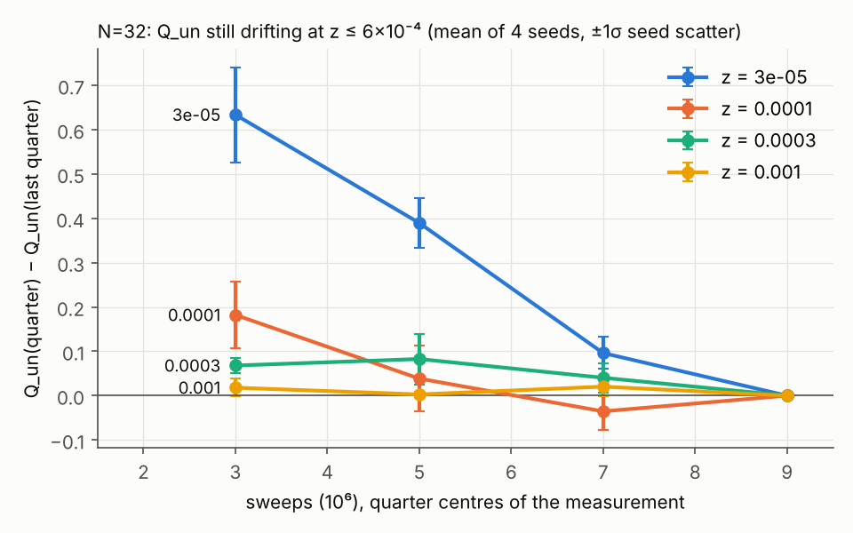
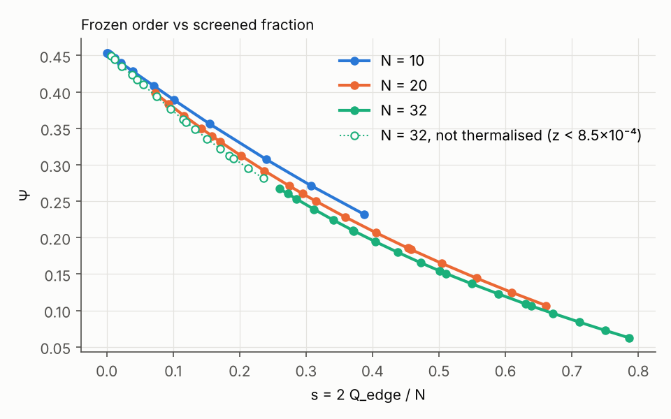

# 1차 중간보고: 과제 A, N=32 (2026-10-29)

## 요약

- 0단계 검증(N=10, N=20)은 세 기준을 모두 통과했다. N=20은 씨앗 8개로 Q_un이 정확값과 1.9σ 안, Ψ가 0.0008 안에서 맞는다.
- N=32 생산 실행(씨앗 4개, 복제본 37개, 2×10⁶ + 8×10⁶ 스윕)이 끝났다. **z ≥ 8.5×10⁻⁴에서는 열화가 확인됐다.** 이 범위의 값은 의뢰서의 국소 MC 기준값(z=10⁻³, 3×10⁻³)과 0.2σ 안에서 맞는다.
- **판가름 창인 z ≤ 6×10⁻⁴는 1,000만 스윕 뒤에도 열화되지 않았다.** 측정 구간 안에서 Q_un이 계속 내려간다. 첫 사분기에서 마지막 사분기까지 z=3×10⁻⁵에서 −0.63(5.9σ), z=10⁻⁴에서 −0.18(2.4σ), z=3×10⁻⁴에서 −0.07(4.1σ)이다. `pt_analyze.py`의 전반·후반 drift 판정은 비닝 오차가 커서 이것을 놓쳤다. 그래서 씨앗 간 편차로 오차를 재는 사분기 경향 판정(`trend.py`)을 추가했다.
- 사다리 문제: 순수 로그 간격 사다리는 z > 0.03에서 이웃 교환 수락률이 0.19, 0.12, 0.07로 기준 0.2에 못 미쳤다. 수락률 예측식으로 사다리를 설계하는 `ladder.py`를 만들었다. N=48에서 첫 체크포인트 기준 최소 수락률이 0.22–0.32다.
- **결론(중간):** 의뢰서의 스윕 예산(∝N²)으로는 z ≲ 10⁻³에서 N=32조차 평형에 닿지 않는다. N=48, 64는 더 나쁠 것이다. 이대로 생산을 계속하면 H1/H2 판가름에 필요한 z = 10⁻⁵–10⁻⁴ 값을 얻을 수 없다. 아래 "결정이 필요한 것"을 참고.

## 1. 검증

| 기준 | 결과 |
|---|---|
| N=10 Q_un, 다섯 z (2σ) | 통과, 최대 0.64σ |
| N=20 Q_un (2σ, 씨앗 8개) | 통과: −1.05, +0.65, +0.88, +1.87, +0.26σ (z=10⁻³…0.1) |
| N=20 Ψ (0.002) | 통과, 최대 차이 0.0008 |
| 열화: drift < 3σ, 씨앗 간 3σ | 통과, drift < 1σ, 씨앗 편차 ≤ 2.4σ |

씨앗 4개만으로는 z=0.1에서 오차가 과소추정됐다(2.8σ로 보였다). 씨앗 8개에서 0.26σ로 해소됐다. 씨앗 간 편차로 재는 오차는 씨앗 4개(자유도 3)에서 불안정하다.

## 2. N=32 결과 (필수 z)

Q_un은 측정 후반부 평균이다. 오차는 씨앗 4개의 편차다. 경향은 첫 사분기에서 마지막 사분기로의 변화이고, t는 그것을 씨앗 편차 오차로 나눈 값이다.

| z | Q_un (후반) | 오차 | 경향 q1→q4 | t | Q_un − log₂(1/z) | s | Ψ | 판정 | 의뢰서 국소 MC |
|---|---|---|---|---|---|---|---|---|---|
| 10⁻⁵ | 15.86 | 0.07 | −0.10 | −1.1 | −0.75 | 0.006 | 0.449 | 신뢰 불가¹ | |
| 3×10⁻⁵ | 15.04 | 0.08 | −0.63 | −5.9 | +0.01 | 0.046 | 0.417 | 미열화 | |
| 10⁻⁴ | 14.03 | 0.03 | −0.18 | −2.4 | +0.74 | 0.119 | 0.359 | 미열화 | 14.24±0.14, Ψ 0.363 |
| 3×10⁻⁴ | 13.02 | 0.03 | −0.07 | −4.1 | +1.31 | 0.185 | 0.313 | 미열화 | 13.27±0.10, Ψ 0.322 |
| 10⁻³ | 11.641 | 0.006 | −0.02 | −0.9 | +1.675 | 0.272 | 0.260 | 열화 | 11.65±0.05, Ψ 0.261 |
| 3×10⁻³ | 10.077 | 0.007 | +0.01 | +0.7 | +1.696 | 0.370 | 0.210 | 열화 | 10.07±0.03, Ψ 0.209 |
| 10⁻² | 7.986 | 0.003 | +0.00 | +0.4 | +1.342 | 0.501 | 0.154 | 열화 | |
| 3×10⁻² | 5.770 | 0.002 | −0.00 | −1.0 | +0.710 | 0.639 | 0.106 | 열화² | |
| 0.1 | 3.418 | 0.003 | −0.00 | −0.9 | +0.096 | 0.786 | 0.062 | 열화² | |

¹ z=10⁻⁵: 씨앗 평균이 단일 실행 비닝 오차의 14배까지 흩어진다. 씨앗 1, 2는 측정 중에도 Q_edge가 계속 커진다.
² 사다리 꼭대기의 수락률이 0.2 미만이었다. 경향과 drift는 없지만, 기준을 맞춘 사다리로 N=32를 다시 돌리는 작업이 대기열 마지막에 있다.

- 열화가 확인된 z=10⁻³, 3×10⁻³에서 Q_un − log₂(1/z) = 1.675, 1.696이다. 의뢰서의 f(32) = 4 ln(32/21) = 1.685와 맞는다. z=10⁻⁴, 3×10⁻⁴의 값은 아직 평형값이 아니다. Q_un이 내려가는 중이므로 평형값은 표보다 작다.
- 의뢰서의 국소 MC 값은 z=10⁻⁴, 3×10⁻⁴에서 이 결과보다 크다(−1.1σ, −2.3σ). 같은 방향의 미열화로 보인다.

그림 1 (`fig1_N32_trend.png`): 사분기별 Q_un에서 마지막 사분기 값을 뺀 것. z ≤ 3×10⁻⁴에서 아직 내려가고 있다.

## 3. Ψ(s) 붕괴

그림 2 (`fig2_psi_vs_s.png`): N=10, 20(검증 실행), 32의 Ψ를 s에 대해 그렸다.

N=32는 N=20 곡선보다 아래에 있고, 열화된 점에서 차이는 s=0.3–0.5에서 −0.012, s=0.6에서 −0.009다. 의뢰서가 N=32–48에서 본 0.012–0.028 하강과 같은 방향이다. 다만 N=10은 반대로 N=20보다 0.011–0.018 위에 있다. 따라서 Ψ(s)는 N=10–32에서 하나의 곡선으로 완전히 붕괴하지 않는다. N이 커질수록 체계적으로 아래로 이동한다.

## 4. 운영상 문제와 조치

- 클라우드 컨테이너가 유휴 상태가 되면 실행 중에도 정지된다. 그래서 체크포인트·재개 기능을 넣었다(`aztec_pt.c`). 5분마다 저장하고, 재개한 결과가 중단 없는 실행과 바이트 단위로 같음을 확인했다. 대기열 `queue.sh`와 연결을 유지하는 대기 작업도 추가했다. 정지로 약 3.5시간을 잃었다.
- 사다리: `run_pt.sh`의 R 자리에 `a0.35`를 주면 `ladder.py`가 예측 수락률 ≥ 0.35인 사다리를 만든다. 예측식 erfc(Δln z·σ_n/2)는 σ_n² = d⟨n⟩/d ln z이며, N=32 실측과 ±0.01로 맞는다. N=64 사다리는 N=48 결과를 기준으로 자동 생성된다.

## 5. 현재 진행과 일정

- N=48(씨앗 4개, 복제본 42개, 4×10⁶ + 1.6×10⁷ 스윕)을 18:55에 시작했다. 씨앗당 약 24.5시간이 걸려 10/30 19시경 끝날 예정이다.
- 대기열 순서는 N=64(복제본 약 50개 내외, 씨앗당 약 3–4일)와 N=32 재실행(새 사다리)이다.

## 6. 결정이 필요한 것

N=32에서 z ≤ 6×10⁻⁴가 평형에 닿지 않았으므로, 같은 예산의 N=48, 64도 판가름 창(z = 10⁻⁵–10⁻⁴)에서 쓸 수 있는 값을 주지 못할 가능성이 크다. 선택지는 다음과 같다.

1. **그대로 진행.** N=48, 64를 의뢰서 예산으로 돌린다(약 5일). z ≥ 10⁻³ 값과 Ψ(s) 이동은 얻지만, H1/H2 판가름은 못 한다.
2. **(추천) 진단 먼저.** N=48을 일시정지한다(SIGSTOP이라 손실은 없다). 그다음 N=32를 새 사다리, 복제본 왕복 시간 계측, 4–5배 긴 실행으로 돌려 z ≤ 10⁻⁴의 실제 이완 시간과 필요한 스윕 수를 잰다. 이 결과로 N=48, 64의 예산을 다시 잡는다. 약 0.5–1일이 걸린다.
3. **알고리즘 개선.** 빈칸을 멀리 옮기는 비국소 갱신(worm/directed-loop형)을 넣어 작은 z의 자기상관을 줄인 뒤 생산한다. 개발과 검증(N ≤ 20 정확값 대조)에 시간이 들지만, 큰 N을 원하면 결국 필요할 수 있다.

## 파일

- `ana32/`: N=32 출력 전체(블록, 히스토그램, 사다리)와 `summary.csv`
- `trend.py`: 사분기 경향 판정 / `ckpt_status.py`: 실행 중 진행률·수락률 / `ladder.py`: 수락률 설계 사다리
- `reports/plot_interim1.py`: 그림 재생성
